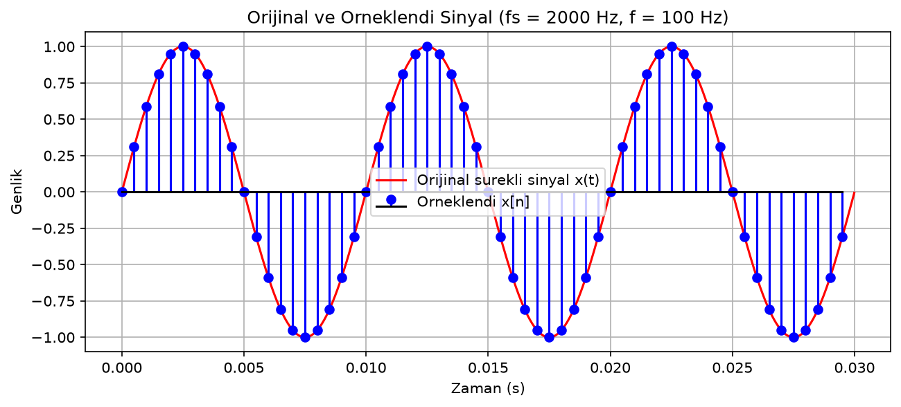
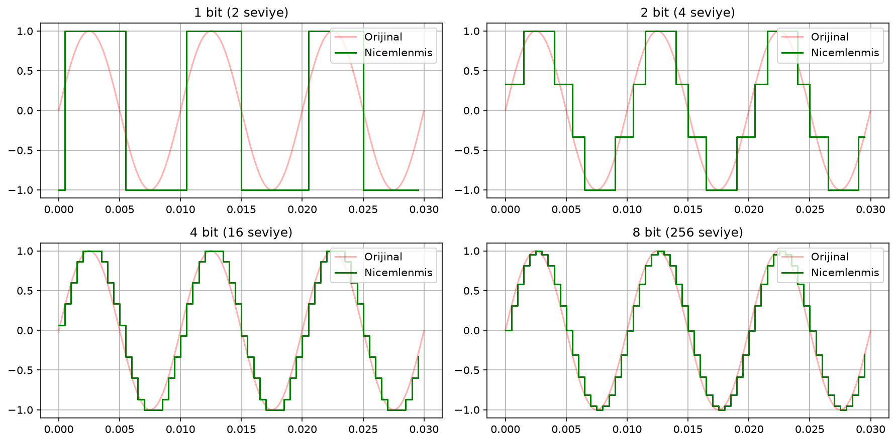
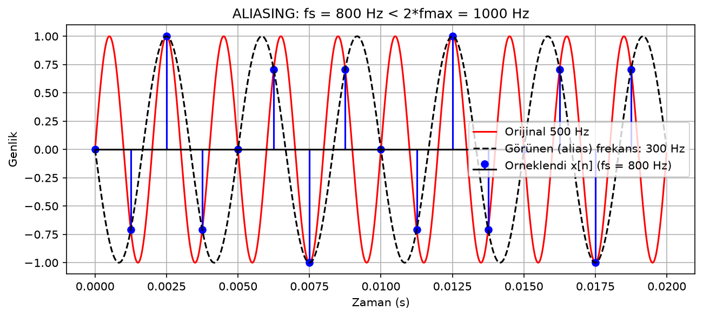

# Sürekli Zamanlı Sinyalin Ayrık Zamanlı Sinyale Dönüştürülmesi

Streamlit tabanlı bir uygulama: sürekli zamanlı (analog) sinyalin, örnekleme ve nicemleme adımlarıyla ayrık zamanlı (dijital) sinyale dönüştürülmesini gösterir. Dönüşüm parametreleri arayüzden değiştirilir, sonuçlar anlık olarak grafik, metrik ve ses olarak sunulur; ayrıca otomatik Word raporu üretilebilir.

## Amaç

Giriş olarak alınan sürekli zamanlı sinyalin gerekli parametrelere göre ayrık zamanlı sinyale dönüştürülmesi. Dönüşümün iki temel adımı olan **örnekleme (sampling)** ve **nicemleme (quantization)** uygulanır; oluşan dijital sinyal orijinal ile karşılaştırılır, Nyquist/aliasing durumu ve SNR değerleri raporlanır.

## Özellikler

- **Sinyal kaynakları**: sentetik sinüs, kare, testere ve çok tonlu sinyal üretimi; WAV dosyası yükleme
- **Örnekleme**: `fs` slider'ı ile, `Ts = 1/fs` otomatik; sentetikte `fmax` sinyalin kendisinden, WAV'da FFT ile içerik bant genişliğinden hesaplanır
- **WAV yeniden örnekleme**: isteğe bağlı anti-aliasing filtresi (`resample_poly`, gcd ile sadeleştirilmiş up/down) veya filtresiz örnekleme ile aliasing'i duyabilme
- **Nyquist / aliasing uyarısı**: `fs <= 2*fmax` olduğunda hata gösterimi; kare ve testere için harmonik kaynaklı aliasing notu
- **Nicemleme**: 1–16 bit (2^b seviye), yuvarlat / yukarı / aşağı modları; ölçülen SNR ile teorik `6.02*bit + 1.76` değeri yan yana (teorik formülün yalnızca tam genlikli sinüs için geçerli olduğu arayüzde belirtilir)
- **Düşük bit / mod uyarısı**: ≤3 bit ve yukarı-aşağı modlarında teorik SNR'nin geçerli olmadığına dair not
- **Canlı arayüz**: dönüşüm butonu yok; slider değişince grafikler ve metrikler anlık güncellenir
- **WAV grafik penceresi**: orijinal, örneklenmiş ve nicemlenmiş için aynı ilk 20 ms penceresi
- **Ses dinleme**: orijinal / örneklenmiş / nicemlenmiş üç oynatıcı (örneklenmiş ve nicemlenmiş diziler 44100 Hz'e genişletilerek sunulur)
- **Bit derinliği karşılaştırması**: 1, 2, 4, 8 bit panosu
- **Rapor üretimi**:
  - sabit örnekli hazır rapor görselleri (`fig1`–`fig5`, akış şeması)
  - o anki ana grafik + bit panelini parametreli dosya adıyla kaydetme (örn. `sinus_f100_fs2000_8bit.png`)
  - `python-docx` ile otomatik `rapor.docx` (kişisel bilgiler `kisisel_bilgiler.json` dosyasından okunur)

## Kurulum

Python 3.9+ önerilir.

```bash
python3 -m venv .venv
source .venv/bin/activate
pip install -r requirements.txt
```

Testleri çalıştırmak için ayrıca:

```bash
pip install pytest
```

## Çalıştırma

### 1. Uygulamayı başlatma

```bash
streamlit run app.py
```

Terminal şunu gösterdiğinde uygulama açılmıştır:

```
You can now view your Streamlit app in your browser.
Local URL: http://localhost:8501
```

- Tarayıcı otomatik açılmazsa `http://localhost:8501` adresini adres çubuğuna yazın.
- macOS'ta Terminal'i `Cmd + Boşluk` ile açıp "Terminal" yazarak başlatabilirsiniz.
- Uygulamayı kapatmak için Terminal'de `Ctrl + C` kombinasyonuna basın.

Sol panelden sinyal kaynağını ve parametreleri seçin; sonuçlar otomatik olarak güncellenir. **WAV** modunda bir `.wav` dosyası yükleyip "Yeniden Ornekle" ve "Anti-aliasing filtresi uygula" seçeneklerini kullanabilirsiniz.

### 2. Testleri çalıştırma

```bash
python3 -m pytest test_sinyal.py -v
```

Alias frekansı, nicemleme seviye sayısı, teorik SNR'ya yakınlık, ek bit başına ~6 dB artış ve Nyquist koşulu kontrol edilir.

### 3. Rapor görsellerini üretme

```bash
python3 rapor_grafikleri.py
```

`fig1`–`fig5` ve akış şeması `rapor_kaynak/` klasörüne kaydedilir.

### 4. Word raporunu üretme

```bash
python3 rapor_uret.py
```

Rapor `rapor_kaynak/rapor.docx` dosyasına yazılır. Ad, öğrenci no, üniversite, ders sorumlusu ve tarih bilgileri `kisisel_bilgiler.json` dosyasından okunur; dosya yoksa veya alan boşsa yer tutucu değerler kullanılır. Şablon için: `kisisel_bilgiler.example.json`.

## Dosya Yapısı

```
.
├── app.py                         # Streamlit arayüzü (canlı güncelleme, grafikler, ses)
├── sinyal_core.py                 # Çekirdek: üretme, ornekleme, nicemleme, SNR, Nyquist, WAV
├── rapor_grafikleri.py            # Rapor görselleri (fig1–fig5, fig_akis)
├── rapor_uret.py                  # python-docx ile otomatik Word raporu
├── test_sinyal.py                 # pytest testleri
├── requirements.txt               # Bağımlılıklar (sürüm sabitli)
├── kisisel_bilgiler.example.json  # Kişisel bilgi şablonu (boş)
├── docs/                          # README için görseller (fig1–fig3)
├── rapor_kaynak/                  # Üretilen görseller + rapor.docx (git'e eklenmez)
└── .gitignore
```

## Şekiller

### Şekil 1 — Orijinal ve örneklenmiş sinyal



### Şekil 2 — Farklı bit derinliklerinde nicemleme



### Şekil 3 — Aliasing (Nyquist ihlali): 500 Hz sinyal, fs = 800 Hz


